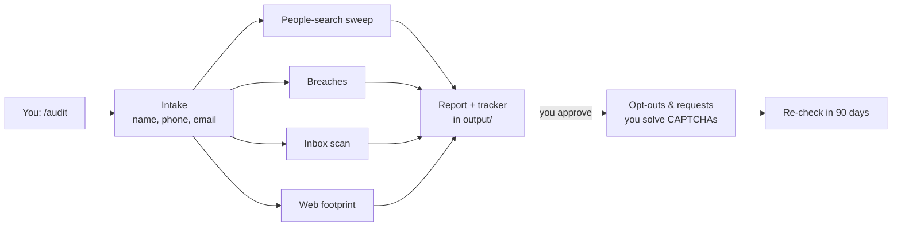

# Privacy Cleanup

**An AI agent that finds your personal info online and helps you remove it.** Open this folder in [Claude Code](https://claude.com/claude-code) or [Codex CLI](https://github.com/openai/codex), type `/audit`, and the agent does the rest. There's no app to install and no server, and nothing about you leaves your computer except the opt-out forms you approve.

> Built by [Omar Alvarez](https://devalva.com). I ran it on myself first: it found my home address on 16 free people-search sites, plus 11 data breaches and 300 archived old posts, and it filed the removals in an afternoon.

---

## What it does

| Step | What the agent does | You |
|---|---|---|
| **Find** | Searches ~50 people-search, background-check and caller-ID sites for your name, phone and email, and confirms each match with 2+ identifiers | Answer a few questions |
| **Breaches** | Lists the breaches you're in and what each leaked | — |
| **Inbox** *(optional)* | Lists every account tied to your email, marks each keep, secure or delete, and flags security alerts as "Was this you?" | Confirm the alerts |
| **Footprint** | Checks old social posts on the Wayback Machine, public profiles, and your own sites and repos (GPS in photos, emails in commits) | — |
| **Report** | Writes a plain-language report, worst first, plus a tracker spreadsheet | Read it |
| **Cleanup** | Fills opt-out forms in your browser and drafts deletion requests citing your state's privacy law | Solve CAPTCHAs, approve sends |
| **Re-check** | Every 90 days, checks which listings came back | `/recheck` |

See a sample: [examples/sample-REPORT.md](examples/sample-REPORT.md) (fictional person).

## Why an agent and not a website?

People-search sites change their layouts, block bots, hide records behind CAPTCHAs and email links, and list you under your relatives' names. A fixed script breaks against that. An agent reads each page the way you would, confirms a listing is really you, adapts when an opt-out link moves, and stops to hand you the parts only a human should do.

All of it is plain Markdown instructions ([AGENTS.md](AGENTS.md) and [playbook/](playbook/)), so you can read exactly what the agent will do before it does it.



## Quick start

**1. Get the folder**
```bash
git clone https://github.com/oalvare6/privacy-cleanup.git
cd privacy-cleanup
```

**2. Open it with your agent**

| Claude Code | Codex CLI |
|---|---|
| `claude` then type `/audit` | `codex --search "Run my privacy audit"` |

**3. Answer the intake questions.** Only your name, email and phone are needed.

### Optional: let it do more

The audit works with just web search. These connections let the agent do the clicking for you:

| Connection | Unlocks | Claude Code | Codex CLI |
|---|---|---|---|
| **Browser** | Filling opt-out forms, reading sites that block bots | Claude in Chrome extension, or `claude mcp add playwright -- npx @playwright/mcp@latest` | `codex mcp add playwright -- npx @playwright/mcp@latest` |
| **Gmail** | Account inventory, security alerts, drafting requests | claude.ai → Settings → Connectors → Gmail | Any Gmail MCP server via `codex mcp add` |
| **Calendar** | 90-day re-check reminder | claude.ai → Connectors → Google Calendar | Without it, you get an `.ics` file |

## How your data stays private

- **Everything about you is written to `output/`**, which git ignores. It can't be committed by accident, even if you fork this repo.
- **The agent only looks until you say go.** No forms, emails or deletions until you approve the cleanup.
- **It drafts and never sends** emails, and never makes a final submit, without your OK.
- **You handle CAPTCHAs and verification calls.** The agent never tries to get around bot checks.
- **It never asks for your SSN, a government ID or your passwords.**
- **It shares the minimum:** each opt-out form gets only the fields it needs.
- **Relatives' listings are only noted.** It acts on them only with that person's permission.
- **`scripts/safety-check.sh`** blocks any commit that contains a value from your profile. Turn it on with:
  ```bash
  ln -sf ../../scripts/safety-check.sh .git/hooks/pre-commit
  ```

Full rules: [AGENTS.md → Safety rules](AGENTS.md#safety-rules-always).

## What's inside

```
AGENTS.md              Instructions every agent reads (Codex reads this directly)
CLAUDE.md              Imports AGENTS.md + Claude Code notes
.claude/commands/      /audit and /recheck
playbook/              One file per phase, 00-intake → 08-recheck
data/sites.csv         52 sites with opt-out links, steps, and which sites share data
templates/             Report, tracker, accounts list, request emails
examples/              A fictional sample report
scripts/               safety-check.sh (pre-commit guard)
output/                YOUR results (git-ignored)
```

## Contributing

Opt-out pages move all the time. If a link in [`data/sites.csv`](data/sites.csv) is dead or a site is missing, open a PR. **Never include real people's data** in issues or PRs. Use example.com addresses and 555-01xx numbers.

## Limits

- It can't remove data breaches. It can only help make the leaked data useless (freezes, new passwords).
- Public records (property, voter rolls, court and business filings) can only be changed at the source, if at all.
- Listings come back, which is why the re-check exists.
- The playbook is US-focused (people-search sites and state privacy laws).
- **This isn't legal advice.** Check deadlines and requirements on each site and under your state's law.

## License

[MIT](LICENSE)
